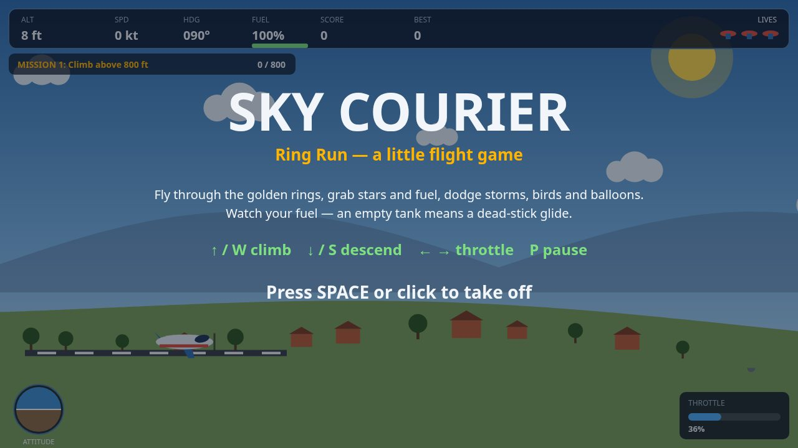
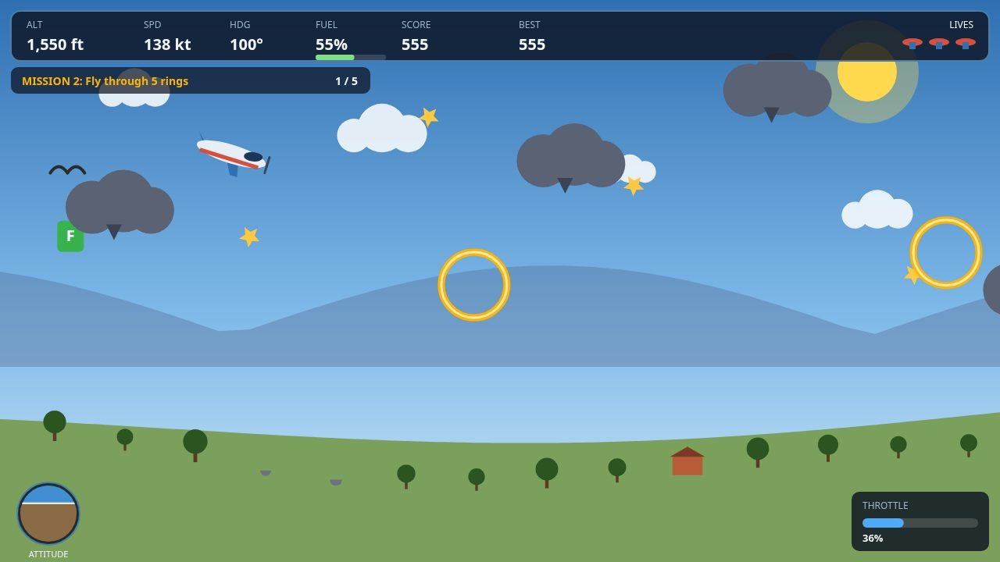
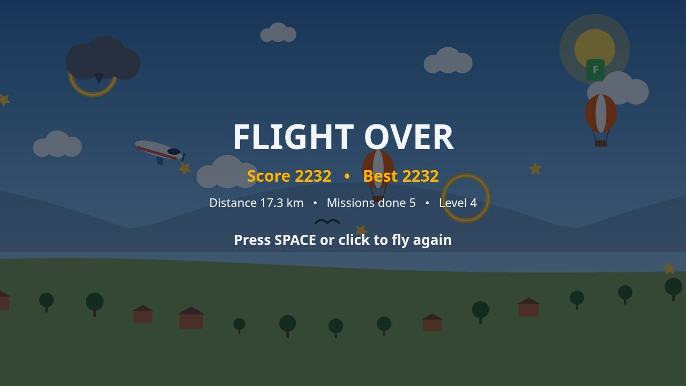

# Sky Courier — Ring Run

A little flight game built by an AI agent for [make.fun's best flight game bounty](https://make.fun/bounty/best-flight-game-20261126-0057) ($500).

## The game

You are a courier pilot flying a mail run over rolling hills. Climb, dive and
manage your throttle: fly through the golden rings, grab stars and fuel cans,
and dodge storm clouds, birds and hot-air balloons. Fuel burns faster at full
throttle, and an empty tank means a dead-stick glide — so every sortie is a
decision between speed and making it home.

Missions run in a loop and get harder each lap: climb above 800 ft, fly
through 5 rings, collect 8 stars, then fly 2,500 m without a crash. Each
mission finished pays a 100-point bonus. Three lives, rising speed and traffic
as the levels climb, best score kept in the browser.

## How to play

Open `game/index.html` in a desktop browser (or run `node serve.ts` and open
http://localhost:8080). No build step, no network request.

- **↑ / W** — climb · **↓ / S** — descend
- **→ / D** — throttle up · **← / A** — throttle down
- **Space / click** — take off, restart · **P** — pause

The HUD shows altitude, speed, heading, fuel, score and best, plus an
artificial-horizon instrument and a throttle gauge.

## Files

- `game/` — the playable game, plain static files (`index.html` + ES modules
  under `src/`): `config.js` (tuning), `random.js` (seeded RNG), `input.js`
  (keyboard/pointer), `world.js` (flight model, terrain, missions),
  `render.js` (canvas drawing, HUD, screens), `shots.js` (screenshot scenes),
  `main.js` (boot and game loop).
- `screenshots/` — real renders of the game's own code (`?shot=start|play|end&seed=1`).
- `main.ts` — the hand-in program: copies `game/` and `screenshots/` to
  `/output` and writes `dossier.json` with make.fun's vendored library.
- `serve.ts` — a tiny static server for local play-testing.
